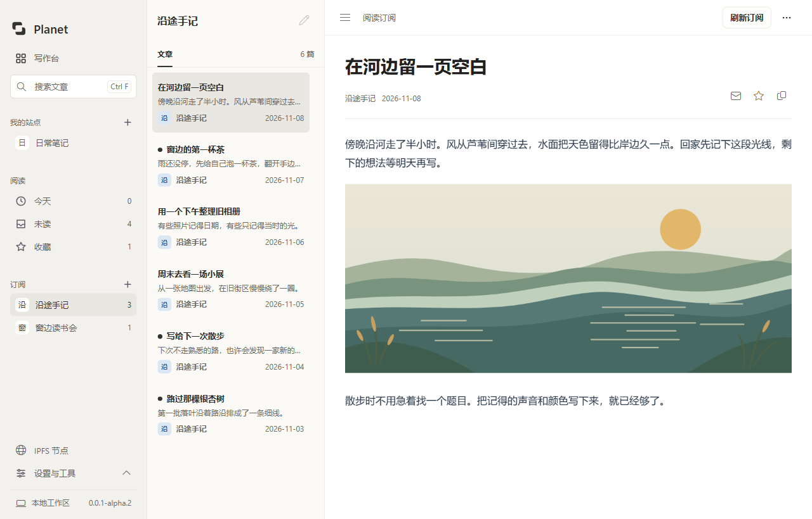

# Planet Windows

<a href="docs/branding/README.md">
  <picture>
    <source media="(prefers-color-scheme: dark)" srcset="docs/branding/planet-horizontal-reversed.svg">
    
  </picture>
</a>

Write a blog, publish it to IPFS, and follow your favorite sites from a Windows desktop app.

> **Upstream project: [Planetable/Planet](https://github.com/Planetable/Planet)**
>
> Planet Windows is an independent Windows port derived from Planet, the original macOS app.

[Download](#download) · [中文使用指南](windows/README.md) · [Run from source](#run-from-source) · [Logo & branding](docs/branding/README.md) · [Contributing](CONTRIBUTING.md)

## Download

**[Download v0.0.1-alpha.2 for Windows x64](https://github.com/Stdq123/planet-windows/releases/download/v0.0.1-alpha.2/planet-windows-safe-setup-0.0.1-alpha.2-amd64.exe)**

Requires Windows x64 and WebView2 Runtime. Install into an empty folder, then open **Planet Windows** from the Start menu. The [release page](https://github.com/Stdq123/planet-windows/releases/tag/v0.0.1-alpha.2) provides release notes, corresponding source, SHA-256 checksums and the final package's acceptance evidence.

> **Unsigned alpha.** Features are still incomplete. Native installer acceptance is limited to seven smoke-test scenarios; use this release's attached results, not evidence from an older package. Windows 10/11 desktop, input-method and recovery testing remain incomplete. Real Mac backup compatibility is unverified. See the [known limitations](windows/README.md#尚未完成与待验证) and [acceptance scope](docs/acceptance-0.0.1-alpha.2.md).

## What you can do

- **Write:** manage sites, Markdown posts, private drafts, tags and attachments.
- **Publish:** share sites through IPFS and IPNS, or export static HTML.
- **Read:** follow RSS, Atom, JSON Feed and supported IPNS / ENS sites; save favorites and pin subscriptions for offline reading.
- **Customize:** use Plain, 8-bit, Grid, Platinum or Sepia, and import or export supported Planet backups.



Reading olivida.eth in Planet Windows. See the [usage guide](windows/README.md) for supported formats, service integrations and their limits.

## Get started

**Follow a site:** select **+** next to **订阅** (Subscriptions), enter a feed URL or a supported website such as `https://olivida.eth.limo`, then select **添加** (Add). Choose an article to read it. If a website does not declare a feed, enter its feed URL directly.

**Start writing:** create a site from the writing dashboard, then create a Markdown post. Use a private draft to keep work local. **Saving an article queues public publication of the entire site and its saved attachments.**

For step-by-step instructions, see [writing](windows/README.md#写作与文章), [publishing](windows/README.md#发布与-ipfs-节点) and [offline reading](windows/README.md#订阅与离线阅读). Published content needs available IPFS nodes or pinning for continued access. Exported backups contain **unencrypted IPNS private keys**; store them securely.

## Run from source

The app uses Go, MyGo, WebView2 and TypeScript. On Windows x64, install Git, Bun, Go 1.27.3 (or a compatible toolchain) and WebView2 Runtime, then run in PowerShell:

```powershell
git clone https://github.com/Stdq123/planet-windows.git
cd planet-windows/windows
bun install --frozen-lockfile
powershell -NoProfile -File scripts/prepare-kubo.ps1
bun run dev
```

This opens the desktop app with the development server. `bun run dev:web` starts only the frontend; desktop features require MyGo.

## Development

Run these commands from `windows/`:

```powershell
bun run check   # Full quality checks and frontend build
bun run build   # Package the app and installer; requires 7-Zip
```

For [documentation-only changes](docs/git-workflow.md#纯文档检查), run `bun run check:docs` instead. Only Git and Bun are needed; no app build is required.

Close Planet and Kubo before packaging. Build output is written to `windows/build/windows-amd64/`. See the [build and test guide](windows/README.md#构建与测试) for optional tests and output details, and the [release guide](docs/releasing.md) for installer validation and publishing.

## Documentation and support

- [中文使用指南](windows/README.md) — everyday use, settings, integrations and compatibility.
- [Upgrade and recovery](windows/docs/safe-upgrade.md) — installation and recovery procedures.
- [Changelog](CHANGELOG.md) — changes in each version.
- [GitHub issues](https://github.com/Stdq123/planet-windows/issues) — bugs and feature requests.
- [Contributing](CONTRIBUTING.md) — development and pull requests; follow the [code of conduct](CODE_OF_CONDUCT.md).
- [Security policy](SECURITY.md) — report security vulnerabilities.

## License

[MIT](LICENSE). Original Planet copyright notices are retained. Third-party dependencies and bundled components have separate licenses listed in [NOTICE.md](NOTICE.md).
