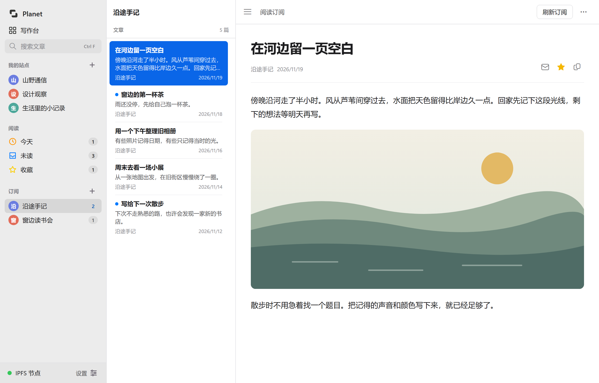
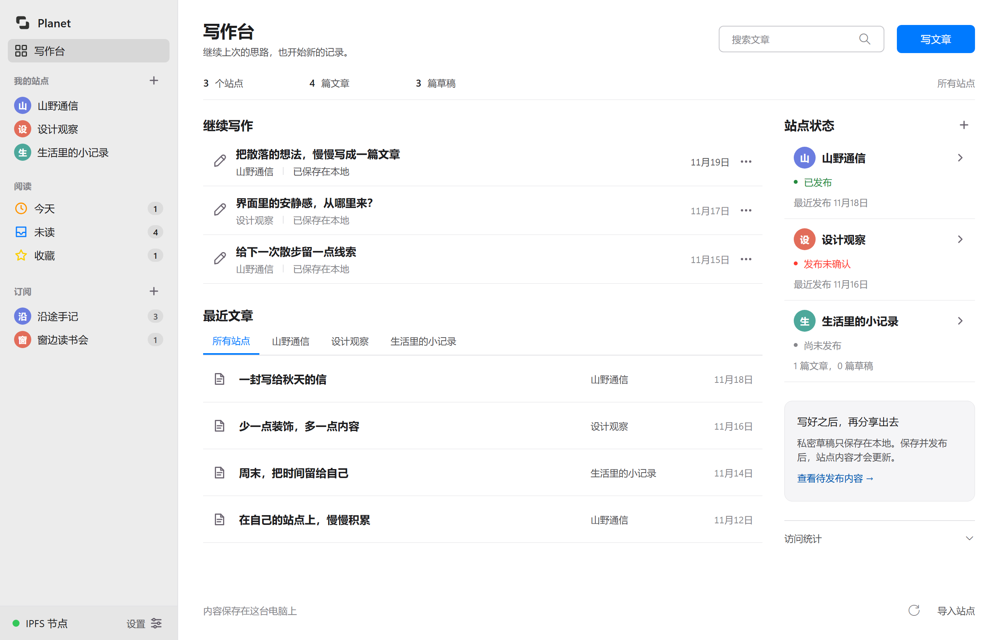
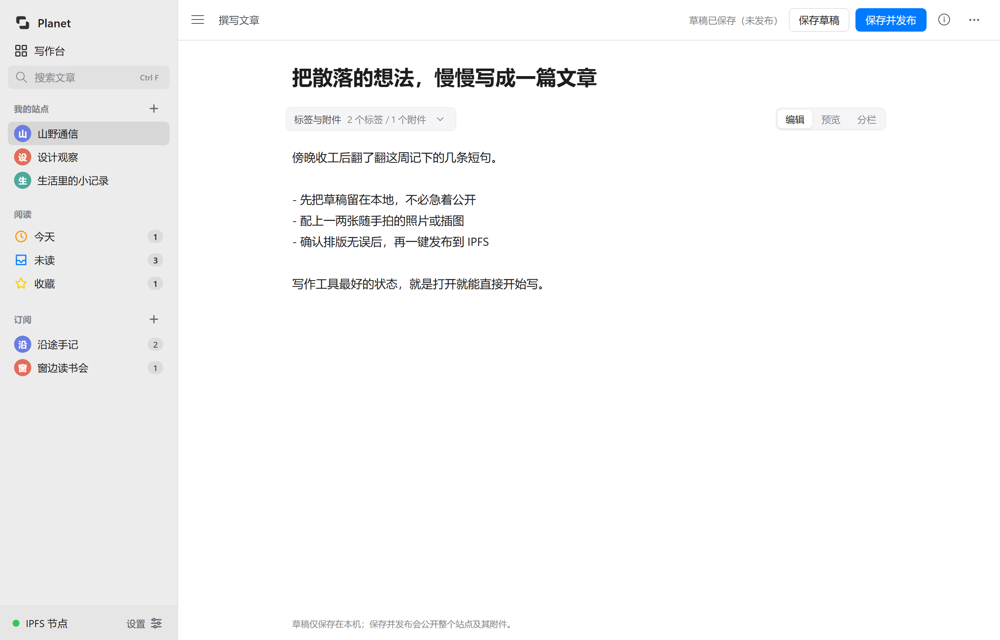
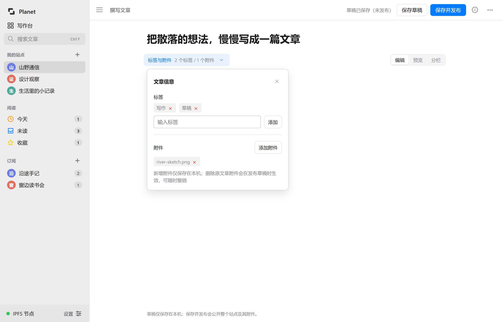

<div align="center">

<a href="docs/branding/README.md">
  <picture>
    <source media="(prefers-color-scheme: dark)" srcset="docs/branding/planet-horizontal-reversed.svg">
    
  </picture>
</a>

<h3>Decentralized blogging, IPFS publishing, and feed reading — built natively for Windows.</h3>

<p>
  <a href="https://github.com/Stdq123/planet-windows/releases"></a>
  <a href="https://github.com/Stdq123/planet-windows/actions/workflows/windows-ci.yml"></a>
  
  <a href="LICENSE"></a>
  <a href="https://awesomemygo.dev/apps/planet-windows"></a>
</p>

<p>
  <strong>English</strong> ·
  <a href="README_zh.md">简体中文</a> ·
  <a href="#download">Download</a> ·
  <a href="#features">Features</a> ·
  <a href="#screenshots">Screenshots</a> ·
  <a href="#build-from-source">Build from Source</a> ·
  <a href="windows/README.md">Full User Guide (中文)</a>
</p>

<br />



<p><sub>An independent Windows port derived from <a href="https://github.com/Planetable/Planet">Planetable/Planet</a> for macOS.</sub></p>

</div>

---

## Features

<table>
  <tr>
    <td width="50%" valign="top">
      <strong>Local-First Writing &amp; Publishing</strong><br />
      Manage multiple sites with a focused Markdown editor, live split preview, local-only private drafts, tags, custom article slugs, standalone pages, attachments, audio/video playback, and <code>podcast.xml</code> generation.
    </td>
    <td width="50%" valign="top">
      <strong>Built-In IPFS &amp; IPNS Node</strong><br />
      Bundles Kubo for automatic IPNS publishing and background renewal, paired with a live traffic chart, public reachability and <code>/p2p-circuit</code> relay diagnostics, local gateway access, and configurable public gateways (<code>eth.sucks</code>, Aleph Cloud, and more).
    </td>
  </tr>
  <tr>
    <td width="50%" valign="top">
      <strong>Feed, ENS &amp; Planet Reader</strong><br />
      Follow RSS, Atom, JSON Feed, website homepages with feed auto-discovery, IPNS names, and ENSIP-15 <code>.eth</code> sites. Automatically fetches site icons and favicons, organizes reading with Smart Feeds (<em>Today</em>, <em>Unread</em>, <em>Favorites</em>), and pins content for offline reading.
    </td>
    <td width="50%" valign="top">
      <strong>Themes, Backups &amp; Integrations</strong><br />
      Ships with 5 upstream templates (<em>Plain</em>, <em>8-bit</em>, <em>Grid</em>, <em>Platinum</em>, <em>Sepia</em>), static HTML export, and <code>.planet</code> backup import/export. Supports Cloudflare Pages, SSH/rsync, Pinnable, Filebase, Plausible analytics, Telegram, and X sync.
    </td>
  </tr>
</table>

## Screenshots

<table>
  <tr>
    <td width="50%" align="center" valign="top">
      
      <br />
      <sub><strong>Writing Dashboard</strong> — Site status, private drafts, and recent posts at a glance.</sub>
    </td>
    <td width="50%" align="center" valign="top">
      
      <br />
      <sub><strong>Markdown Editor</strong> — Distraction-free authoring with local drafts and explicit publish actions.</sub>
    </td>
  </tr>
  <tr>
    <td colspan="2" align="center">
      
      <br />
      <sub><strong>Tags, Attachments &amp; Split View</strong> — Manage article metadata and media inline inside the workspace.</sub>
    </td>
  </tr>
</table>

## Download

| Build | Platform | Requirements | Checksums & Notes |
| --- | --- | --- | --- |
| **[Planet Windows v0.0.1-alpha.6](https://github.com/Stdq123/planet-windows/releases/download/v0.0.1-alpha.6/planet-windows-safe-setup-0.0.1-alpha.6-amd64.exe)** | Windows x64 | Windows 10/11 + WebView2 Runtime | [Release page](https://github.com/Stdq123/planet-windows/releases/tag/v0.0.1-alpha.6) (SHA-256, source archive, acceptance evidence) |

Install into an empty directory, then launch **Planet Windows** from the Start menu.

> [!NOTE]
> **Early unsigned alpha.** Windows SmartScreen may prompt when running the installer — verify the published SHA-256 checksum on the release page before installing. Native desktop GUI, IME, cross-version upgrade, and macOS `.planet` round-trip compatibility remain under verification. See [known limitations](windows/README.md#尚未完成与待验证) and the [alpha.6 acceptance scope](docs/acceptance-0.0.1-alpha.6.md).

> [!WARNING]
> Exported `.planet` backups contain **unencrypted IPNS private keys**. Keep backup archives private and stored safely.

## Quick Start

- **Follow a site:** Click **+** next to **订阅** (Subscriptions), enter a website URL (such as `https://olivida.eth.limo`), an RSS/Atom/JSON Feed URL, an IPNS address, or an ENS `.eth` name, then click **添加** (Add).
- **Create & publish a site:** Create a site from the writing dashboard and start a Markdown post. Use **保存草稿** (Save Draft) to keep work local; **保存并发布** (Save & Publish) queues public IPFS/IPNS publication of the site and its saved attachments.

> The application interface is currently in Simplified Chinese. Step-by-step guides for writing, publishing, offline pinning, and service integrations are available in the [full Chinese user guide](windows/README.md).

## Build from Source

**Prerequisites:** Windows x64, Git, [Go 1.27.4](https://go.dev/dl/) (or compatible toolchain), [Bun](https://bun.sh/), WebView2 Runtime, and [7-Zip](https://www.7-zip.org/) (only required for installer packaging).

```powershell
git clone https://github.com/Stdq123/planet-windows.git
cd planet-windows/windows
bun install --frozen-lockfile
powershell -NoProfile -File scripts/prepare-kubo.ps1
bun run dev
```

### Common Commands

Run all commands from `windows/`:

| Command | Purpose |
| --- | --- |
| `bun run dev` | Start the desktop app with live reload (`bun run dev:web` starts frontend only) |
| `bun run check` | Run full quality checks: docs, `gofmt`, `go vet`, frontend tests, Go tests, TypeScript, Vite build |
| `bun run check:docs` | Lightweight check for [documentation-only changes](docs/git-workflow.md#纯文档检查) (Git + Bun only) |
| `bun run security:check` | Run dependency vulnerability audit (requires network access) |
| `bun run build` | Package the desktop app and installer into `windows/build/windows-amd64/` (close Planet/Kubo first) |

## Tech Stack

- **Desktop runtime:** [MyGo](https://github.com/egoist/mygo) + Windows WebView2
- **Backend & IPFS:** Go + bundled [Kubo](https://github.com/ipfs/kubo)
- **Frontend:** TypeScript + Vite

## Documentation & Support

- [简体中文主页](README_zh.md) · [完整使用指南](windows/README.md) — daily usage, settings, integrations, and compatibility details.
- [Upgrade & Recovery](windows/docs/safe-upgrade.md) — installation, upgrade, and recovery procedures.
- [Changelog](CHANGELOG.md) — version history and unreleased changes.
- [Logo & Branding](docs/branding/README.md) — brand guidelines and SVG assets.
- [Contributing](CONTRIBUTING.md) · [Git Workflow](docs/git-workflow.md) · [Releasing](docs/releasing.md) — development and release workflows.
- [Security Policy](SECURITY.md) · [Issues](https://github.com/Stdq123/planet-windows/issues) — vulnerability reporting, bugs, and feature requests.

## Acknowledgements

Planet Windows is an independent Windows port inspired by and derived from [Planetable/Planet](https://github.com/Planetable/Planet). Built with [MyGo](https://github.com/egoist/mygo) and [IPFS Kubo](https://github.com/ipfs/kubo).

## License

Licensed under the [MIT License](LICENSE). Original Planet copyright notices are retained; third-party dependencies and bundled components are listed in [NOTICE.md](NOTICE.md).
