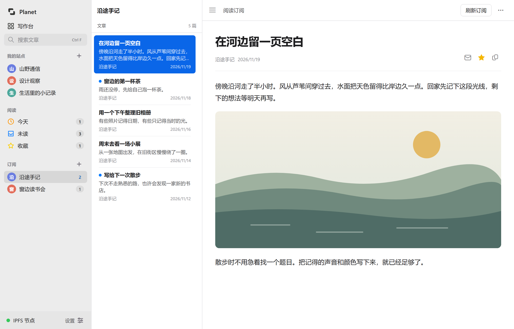
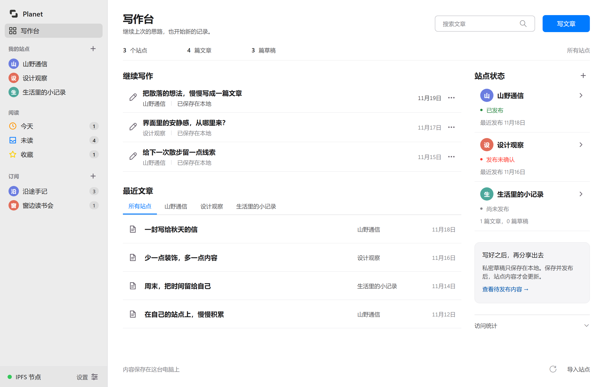
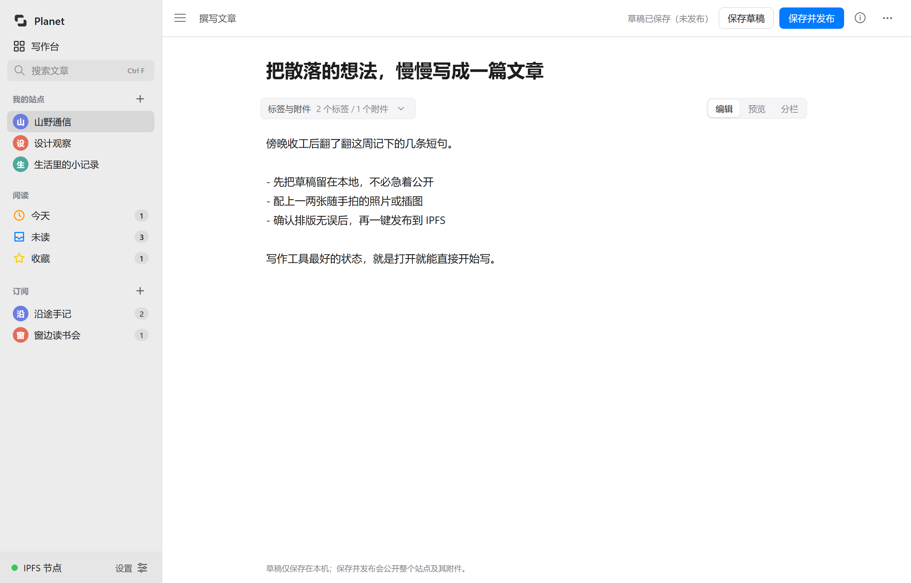
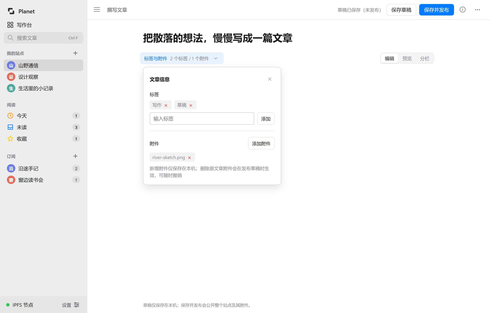

<div align="center">

<a href="docs/branding/README.md">
  <picture>
    <source media="(prefers-color-scheme: dark)" srcset="docs/branding/planet-horizontal-reversed.svg">
    
  </picture>
</a>

<h3>面向 Windows 的去中心化博客写作、IPFS 发布与订阅阅读桌面应用。</h3>

<p>
  <a href="https://github.com/Stdq123/planet-windows/releases"></a>
  <a href="https://github.com/Stdq123/planet-windows/actions/workflows/windows-ci.yml"></a>
  
  <a href="LICENSE"></a>
  <a href="https://awesomemygo.dev/apps/planet-windows"></a>
</p>

<p>
  <a href="README.md">English</a> ·
  <strong>简体中文</strong> ·
  <a href="#下载安装">下载安装</a> ·
  <a href="#核心特性">核心特性</a> ·
  <a href="#界面预览">界面预览</a> ·
  <a href="#从源码运行">从源码运行</a> ·
  <a href="windows/README.md">完整使用指南</a>
</p>

<br />



<p><sub>基于 macOS 原版 <a href="https://github.com/Planetable/Planet">Planetable/Planet</a> 独立开发的 Windows 移植版本。</sub></p>

</div>

---

## 核心特性

<table>
  <tr>
    <td width="50%" valign="top">
      <strong>本地优先的写作体验</strong><br />
      多站点管理、专注 Markdown 编辑器与实时分栏预览、仅保存在本机的私有草稿、文章标签、自定义路径、独立页面、附件与音视频播放，以及 <code>podcast.xml</code> 播客生成。
    </td>
    <td width="50%" valign="top">
      <strong>内置 IPFS / IPNS 节点</strong><br />
      随包内置 Kubo 节点，支持自动发布与后台 IPNS 续期，提供实时收发流量图、公网可达性与 <code>/p2p-circuit</code> 中继状态检测、本地网关打开以及可切换公共网关（默认 <code>eth.sucks</code>、Aleph Cloud 等）。
    </td>
  </tr>
  <tr>
    <td width="50%" valign="top">
      <strong>订阅、ENS 与离线阅读</strong><br />
      支持 RSS、Atom、JSON Feed、网站首页自动发现、IPNS 与 ENSIP-15 <code>.eth</code> 站点；自动抓取站点图标与网站 favicon；提供「今天 / 未读 / 收藏」智能视图，支持 IPFS 固定与离线媒体快照。
    </td>
    <td width="50%" valign="top">
      <strong>原版模板、备份与外部集成</strong><br />
      内置 5 套原版模板（<em>Plain</em>、<em>8-bit</em>、<em>Grid</em>、<em>Platinum</em>、<em>Sepia</em>）及示例预览；支持静态 HTML 导出与 <code>.planet</code> 备份导入导出；集成 Cloudflare Pages、SSH/rsync、Pinnable、Filebase、Plausible 统计、Telegram 与 X 同步。
    </td>
  </tr>
</table>

## 界面预览

<table>
  <tr>
    <td width="50%" align="center" valign="top">
      
      <br />
      <sub><strong>写作台</strong> — 一览所有站点状态、私有草稿与最近文章。</sub>
    </td>
    <td width="50%" align="center" valign="top">
      
      <br />
      <sub><strong>Markdown 编辑器</strong> — 专注写作，清晰区分本地私有草稿与公开发布。</sub>
    </td>
  </tr>
  <tr>
    <td colspan="2" align="center">
      
      <br />
      <sub><strong>标签、附件与分栏预览</strong> — 在编辑区原地管理文章元数据与媒体文件。</sub>
    </td>
  </tr>
</table>

## 下载安装

| 版本 | 适用平台 | 运行环境 | 校验与说明 |
| --- | --- | --- | --- |
| **[Planet Windows v0.0.1-alpha.6](https://github.com/Stdq123/planet-windows/releases/download/v0.0.1-alpha.6/planet-windows-safe-setup-0.0.1-alpha.6-amd64.exe)** | Windows x64 | Windows 10/11 + WebView2 Runtime | [Release 页面](https://github.com/Stdq123/planet-windows/releases/tag/v0.0.1-alpha.6)（含 SHA-256、源码归档与验收附件） |

安装到空目录后，从开始菜单打开 **Planet Windows** 即可使用。

> [!NOTE]
> **早期未签名 Alpha 版本。** 运行安装包时 Windows SmartScreen 可能会给出提示，安装前建议核对 Release 页面提供的 SHA-256 校验值。Windows 10/11 完整桌面界面、输入法、跨版本升级及真实 Mac `.planet` 备份双向兼容仍在持续验证中，详见[已知限制](windows/README.md#尚未完成与待验证)与 [alpha.6 验收范围](docs/acceptance-0.0.1-alpha.6.md)。

> [!WARNING]
> 导出的 `.planet` 备份包含**未加密的 IPNS 私钥**，请妥善保管，切勿上传到公开仓库或网盘。

## 快速上手

- **订阅站点**：点击侧栏 **订阅** 旁的 **+**，输入网站首页（例如 `https://olivida.eth.limo`）、RSS / Atom / JSON Feed 地址、IPNS 地址或 `.eth` 域名，点击 **添加** 即可开始阅读。
- **创建并发布站点**：在写作台新建站点并撰写 Markdown 文章。**保存草稿**仅保存在本机；**保存并发布**会自动将整个站点及已保存附件公开发布到 IPFS / IPNS。

详细功能说明、快捷键、离线固定与各项第三方服务配置请参阅[完整使用指南](windows/README.md)。

## 从源码运行

**环境准备**：Windows x64、Git、[Go 1.27.4](https://go.dev/dl/)（或兼容工具链）、[Bun](https://bun.sh/)、WebView2 Runtime；如需打包安装程序还需安装 [7-Zip](https://www.7-zip.org/)。

```powershell
git clone https://github.com/Stdq123/planet-windows.git
cd planet-windows/windows
bun install --frozen-lockfile
powershell -NoProfile -File scripts/prepare-kubo.ps1
bun run dev
```

### 常用开发命令

以下命令均在 `windows/` 目录执行：

| 命令 | 说明 |
| --- | --- |
| `bun run dev` | 启动桌面应用开发环境（`bun run dev:web` 仅启动前端预览） |
| `bun run check` | 运行完整质量检查：文档、Go 格式、`go vet`、前端测试、Go 测试、TypeScript 与生产构建 |
| `bun run check:docs` | 仅修改[文档白名单](docs/git-workflow.md#纯文档检查)时的轻量检查（仅需 Git 和 Bun） |
| `bun run security:check` | 运行依赖漏洞安全扫描（需联网） |
| `bun run build` | 构建程序与独立安装包，输出到 `windows/build/windows-amd64/`（构建前先关闭 Planet/Kubo） |

## 技术栈

- **桌面壳层**：[MyGo](https://github.com/egoist/mygo) + Windows WebView2
- **后端与 IPFS**：Go + 内置 [Kubo](https://github.com/ipfs/kubo)
- **前端界面**：TypeScript + Vite

## 文档与支持

- [English README](README.md) · [完整使用指南](windows/README.md) — 日常操作、站点设置、服务集成与兼容性说明。
- [升级与恢复指南](windows/docs/safe-upgrade.md) — 安装、升级与异常恢复流程。
- [更新日志](CHANGELOG.md) — 各版本变更与未发布改动记录。
- [Logo 与品牌规范](docs/branding/README.md) — 品牌视觉说明与矢量素材。
- [贡献指南](CONTRIBUTING.md) · [Git 协作指南](docs/git-workflow.md) · [发布流程](docs/releasing.md) — 开发协作与发版规范。
- [安全政策](SECURITY.md) · [GitHub Issues](https://github.com/Stdq123/planet-windows/issues) — 漏洞反馈、缺陷提交与功能建议。

## 致谢

Planet Windows 是基于 [Planetable/Planet](https://github.com/Planetable/Planet) 独立开发的 Windows 移植版本，感谢上游项目以及 [MyGo](https://github.com/egoist/mygo) 和 [IPFS Kubo](https://github.com/ipfs/kubo) 社区。

## 许可证

采用 [MIT 许可证](LICENSE)。保留原版 Planet 版权声明；第三方依赖与随包组件许可证见 [NOTICE.md](NOTICE.md)。
