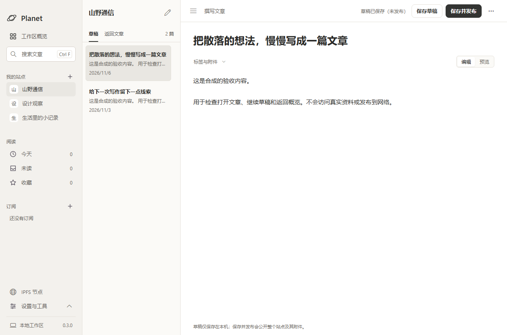
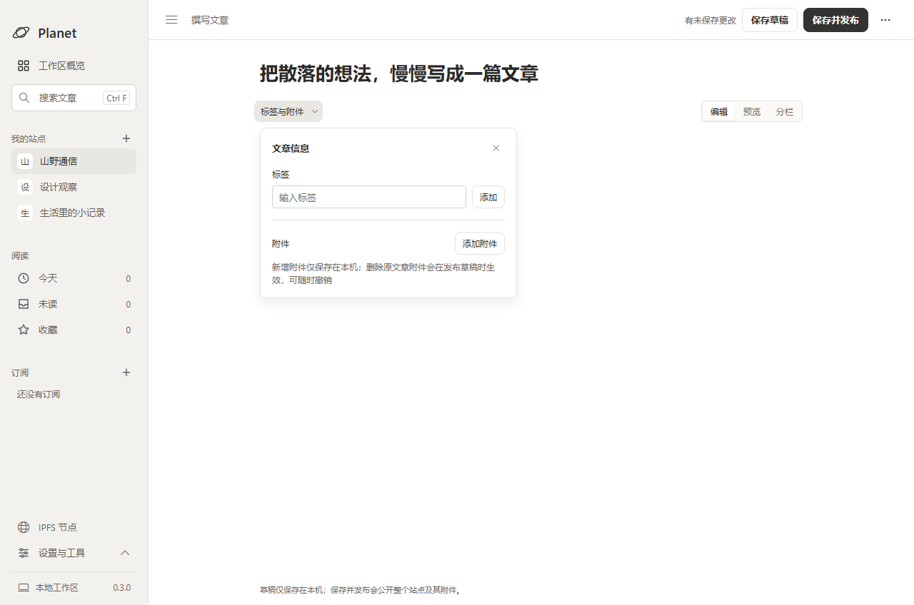

# Figma writing workspace

Source: [approved Figma proposal](https://www.figma.com/design/C7q0U2bLBOQihrNC6hYKjT?node-id=3-51). The writing desk (写作台) is ready for integration through the normal pull-request checks. Local preview packages remain development builds; merging this UI does not publish a release.

The overview places drafts and recent articles first. Totals are an inline summary; site status moves above the content at widths up to 1100px. Navigation uses a warm white surface and 36px rows. Following the user's review, graphite controls and warm gray selection replace the original Figma purple throughout the application. The existing Windows title bar remains native.

The application keeps Segoe UI / Microsoft YaHei UI. Figma used Noto Sans SC because the Windows fonts were unavailable there; heading weights are adjusted for the installed Chinese font. The implementation preserves existing subscriptions, node controls, manual analytics and editor flows. Private drafts correctly say they are saved locally rather than claiming autosave.

Writing opens the editor immediately for one site and asks for the destination when multiple sites exist. Site filters apply to the recent metadata snapshot, not the entire archive; an unmatched filter offers an entry to the complete site. Recent lists expand without fetching article bodies.

## Assets

`windows/resources/workspace/*.svg` contains the SVG exports from this Figma file: planet, navigation, writing, article, disclosure and empty-state marks. The neutral-palette revision changes purple strokes and fills to graphite; paths and intrinsic dimensions are retained. They are packaged locally; temporary Figma asset URLs are not runtime dependencies. No UI framework or dependency was added.

## Writing refinement

Writing uses a 208px navigation rail and an optional 248px article list. The title and body share a 760px maximum text width. Compact article rows put titles first, with a single-line excerpt and secondary date. The tag/attachment panel is anchored below its button; opening it does not push the body down. It closes on its close button, Escape or an outside click, preserves uncommitted tags, and does not consume IME composition keys. An outside click leaves focus with its destination. Manually expanding the article list survives a window resize.

The header retains distinct local-draft and public-save actions. Publication details move to the existing more menu; status remains visible in both writing and reading modes. The footer and publish-button description continue to explain that publication covers the whole site and saved attachments. There is no new autosave or formatting behavior.

## Verification

- Shared `bun run check`: Go formatting/static analysis, frontend tests, uncached Go tests, TypeScript and production frontend build passed.
- Subsequent targeted overview/navigation tests cover destination-site selection, dismissal, stale requests, safe text rendering, recent-list expansion, filtering and publication feedback.
- Real Edge rendering checked at 1280×848, 1024×848 and 860×600 with synthetic normal, empty and read-failure data. The 1280 and 1024 views expose seven and six content rows respectively.
- Hover, keyboard focus, sidebar tools, search, writing-site dialog, draft navigation and retry were exercised. No JavaScript errors, missing images, horizontal overflow or clipped shadows were detected (`cut: 0`, `hidden: 0`).
- The neutral writing revision passes 147 frontend tests. Its real-browser pass checks 45 writing interactions at three sizes, including list expansion, metadata dismissal, publication-dialog focus, preview/split content preservation and textarea scrolling. A separate 860px fixture combines an imported-content warning with a long attachment list; the popover reserves 32px for its shadow and scrolls without clipping or moving the text.
- Native packaging and preview are recorded after the local build. No real publishing, install/upgrade/uninstall acceptance or optional online integration tests are implied.

