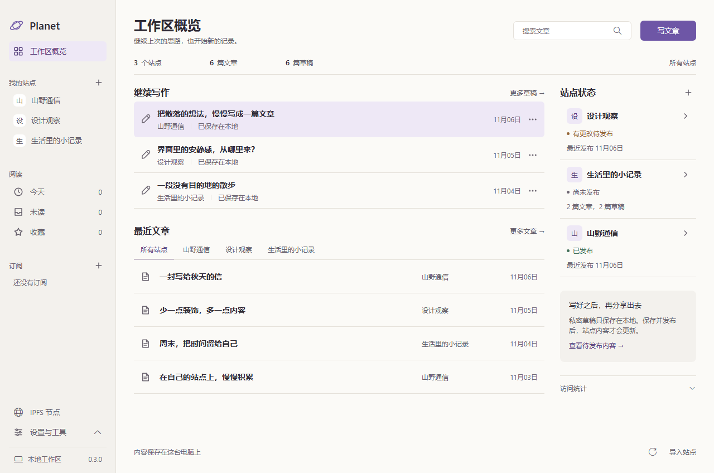

# Figma writing workspace

Source: [approved Figma proposal](https://www.figma.com/design/C7q0U2bLBOQihrNC6hYKjT?node-id=3-51). This iteration lives on `feat/figma-writing-workspace` and is a local preview, not a release or main-branch merge.

The overview places drafts and recent articles first. Totals are an inline summary; site status moves above the content at widths up to 1100px. Navigation uses a warm white surface, 36px rows and restrained purple selection. The existing Windows title bar remains native.

The application keeps Segoe UI / Microsoft YaHei UI. Figma used Noto Sans SC because the Windows fonts were unavailable there; heading weights are adjusted for the installed Chinese font. The implementation preserves existing subscriptions, node controls, manual analytics and editor flows. Private drafts correctly say they are saved locally rather than claiming autosave.

Writing opens the editor immediately for one site and asks for the destination when multiple sites exist. Site filters apply to the recent metadata snapshot, not the entire archive; an unmatched filter offers an entry to the complete site. Recent lists expand without fetching article bodies.

## Assets

`windows/resources/workspace/*.svg` contains the original SVG exports from this Figma file: planet, navigation, writing, article, disclosure and empty-state marks. Their intrinsic dimensions are retained. They are packaged locally; temporary Figma asset URLs are not runtime dependencies. No UI framework or dependency was added.

## Verification

- Shared `bun run check`: Go formatting/static analysis, frontend tests, uncached Go tests, TypeScript and production frontend build passed.
- Subsequent targeted overview/navigation tests cover destination-site selection, dismissal, stale requests, safe text rendering, recent-list expansion, filtering and publication feedback.
- Real Edge rendering checked at 1280×848, 1024×848 and 860×600 with synthetic normal, empty and read-failure data. The 1280 and 1024 views expose seven and six content rows respectively.
- Hover, keyboard focus, sidebar tools, search, writing-site dialog, draft navigation and retry were exercised. No JavaScript errors, missing images, horizontal overflow or clipped shadows were detected (`cut: 0`, `hidden: 0`).
- Native packaging and preview are recorded after the local build. No real publishing, install/upgrade/uninstall acceptance or optional online integration tests are implied.

