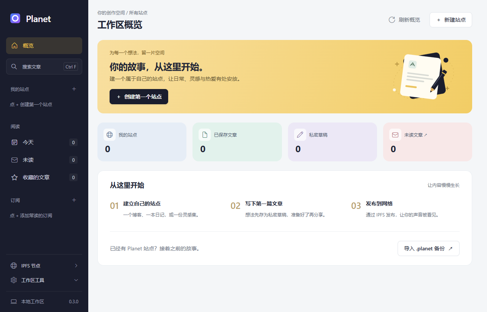
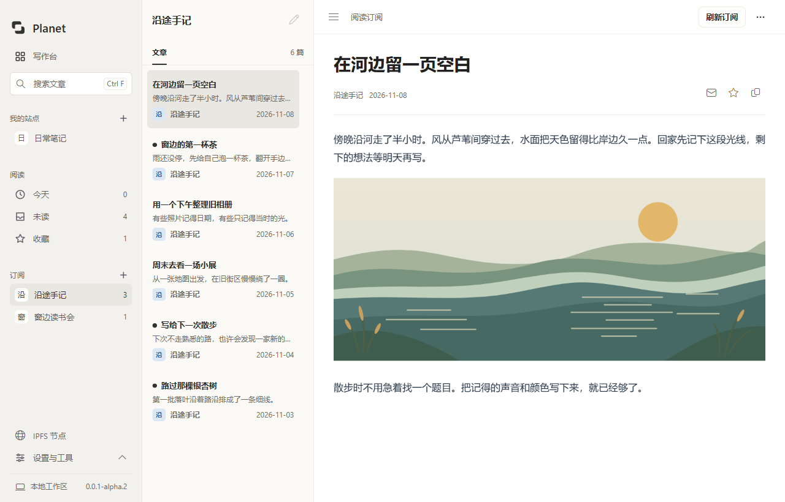

# Planet Windows（开发中）

> **上游项目（原版）：[Planetable/Planet](https://github.com/Planetable/Planet)**
>
> Planet Windows 基于上述上游项目，是独立开发的 Windows 移植版本。

本项目使用 Go、MyGo、WebView2 和 TypeScript，不使用 Electron 或 Swift。当前为开发版本，尚不具备原版的完整功能；原版数据兼容性仍需要真实 Mac 备份验证。

**首个公开预发布目标：`v0.0.1-alpha.1`。** 此前 `0.3.0` 等编号属于未打发行标签的开发快照；本次重新确定公开编号，尚未通过全部[发行检查](../docs/releasing.md)。已有 `0.2.0`/`0.3.0` 开发安装会拒绝这次降级，请在隔离的新 Windows 用户环境测试 alpha，并保留原安装和资料。

[English README](../README.md) · [贡献指南](../CONTRIBUTING.md) · [发行检查记录](docs/release-audit.md)

本文按日常操作介绍当前已实现的功能。支持范围和验证情况以各节说明及“尚未完成与待验证”为准。

## 目录

- [快速开始](#快速开始)
- [写作与文章](#写作与文章)
- [站点设置与管理](#站点设置与管理)
- [发布与 IPFS 节点](#发布与-ipfs-节点)
- [订阅与离线阅读](#订阅与离线阅读)
- [备份与模板](#备份与模板)
- [服务集成](#服务集成)
- [构建与测试](#构建与测试)
- [安装与升级](#安装与升级)
- [尚未完成与待验证](#尚未完成与待验证)

## 快速开始

### 写作台



启动后默认显示写作台，汇总所有站点的文章、私密草稿和订阅未读数量，以及最近修改的草稿、文章与各站点发布状态。可在顶部选择站点开始写作，或点击草稿继续编辑；侧栏“写作台”可随时返回，未保存的修改仍会先提示确认。没有站点时，可创建新站点或导入 `.planet` 备份。

写作台只读取本机元数据。IPFS 节点详情和 Plausible 访问统计由用户主动打开或查询；未配置统计或查询失败会显示说明，不会用零值代替。

常用保存与发布操作位于顶栏，其余站点操作位于“更多操作”菜单，备份与网关设置在侧栏“更多工具”。

### 添加并阅读订阅



在 Planet Windows 中阅读 olivida.eth 的订阅文章。

1. 点击侧栏“订阅”旁的 **+**。
2. 输入 RSS、Atom 或 JSON Feed 地址，也可以输入支持的网站首页（例如 `https://olivida.eth.limo`）、IPNS 地址或 ENS 名称（例如 `olivida.eth`），然后点击“添加”。
3. 在侧栏选择订阅，再选择文章阅读。点击“刷新订阅”可手动更新；点击文章页的收藏按钮后，可在侧栏“收藏的文章”中找到它。
4. 需要离线阅读时，选中订阅并点击“更多操作 → 固定离线”。固定完成后可读取已保存的内容；不同订阅类型支持的媒体和大小限制见下文。

网页地址会尝试发现页面声明的订阅源；如果网站没有声明订阅源，请直接输入其 Feed 地址。直接输入 `.eth` 名称会使用 ENS/IPFS 订阅流程。普通网页订阅的在线文章支持显示图片及正文中的音视频；收藏或取消收藏时不会重新加载文章内容。

## 写作与文章

创建多个本地站点，创建、编辑、保存和删除 Markdown 文章，预览文章。

### 文章阅读与设置

已保存的文章先在阅读界面打开，可再进入编辑；已发布站点的文章可以按所选公共网关复制链接，存在未发布更改时会提示。

搜索可查找本地站点文章和已缓存的订阅内容。

本地站点的已保存文章可以设置小写自定义路径、文章或独立页面类型、HTTP(S) 外部跳转链接及站点导航权重。独立页面不进入首页文章列表或 RSS；导航按权重升序排列。发布时同时生成原文章 ID 路径和自定义路径及附件；更改路径后旧自定义路径不再生成，文章 ID 路径保持可用。支持的五套原版模板已做针对性渲染检查。

### 私有草稿

文章支持本机私有草稿，草稿及其新增附件不会进入网页、IPFS 发布或 `.planet` 备份；发布草稿时会保存为文章并排队发布整个站点。先保存草稿，再添加附件；也可标记删除原文章附件，并在发布前撤销，删除只有发布草稿后才生效。草稿可关联已保存的文章，如原文后来发生变化会阻止直接覆盖。删除或发布后未能清理的附件会在下次启动时重试清理。

### 附件与媒体

本地及导入站点均可为已保存的文章添加或删除附件；附件立即保存或删除，系统插入的 Markdown 引用需要保存文章，删除附件时须自行删除不再需要的引用。发布、网页导出及备份会携带已保存附件。发布期间的附件操作可能需要等待发布结束，等待时不能保存或切换站点。

编辑器的隔离预览可显示当前文章已登记的 PNG、JPEG、GIF 和 WebP 附件（单文件最多 8 MiB，总计最多 16 MiB）；外部图片和 SVG 不在预览中加载，发布后的页面仍可引用附件。

本地和导入站点的已登记音频可通过全局播放器播放，支持切换站点时继续播放和拖动进度；播放依赖 WebView2 支持的格式。

文章保存音视频文件名，公开元数据包含音频字节数及可识别的时长；WAV 时长可直接读取，其他格式优先使用 Windows 媒体属性处理器，本机 PATH 中的 `ffprobe` 可作为备用；视频缩略图由可用的 Windows 缩略图处理器生成。

订阅中声明为音频的附件可在全局播放器中播放。

### 标签

本地及兼容的导入站点可为文章和私有草稿添加、移除标签；标签随文章或草稿一起保存，草稿发布前不会公开。默认模板和受支持的原版模板可重建标签索引及筛选页面。原备份的标签格式无法识别时会保留原始元数据并禁用该站点的标签编辑；旧标签页只有能与原始快照或新页面匹配时才会在备份中替换，无法确认归属时会拒绝重建并保留原归档。

由于真实 Mac 的模板版本或渲染结果可能不同，部分正常备份也可能需要保守拒绝。

## 站点设置与管理

### 站点资料

可修改站点名称和简介；修改后站点标记为尚未发布。

本地站点可以设置头像、作者名称和站点标识。头像支持 PNG、JPEG 和 GIF，选择后保存为 PNG 并生成浏览器图标；站点标识用于之后新建文章的编号前缀，不改变已有编号。头像操作自动排队发布，其他站点信息需手动重新发布。

### 域名、社交资料与搜索收录

本地站点可设置自定义域名及 Twitter、GitHub、Telegram、Mastodon 和 Discord 社交资料，重新发布后进入站点页面及公开元数据。普通域名使用 HTTPS 地址，ENS 复制地址使用所选网关；域名解析、ENS 内容记录和 HTTPS 服务需要自行配置，网关对 ENS 的支持与可用性可能不同。

新建的本地站点可在站点设置中要求搜索引擎不收录：重新发布后通过 `robots.txt` 表达此偏好。该设置不限制任何人访问公开内容；导入站点的对应设置暂不支持修改。

### 播客设置

本地站点可设置播客语言、内容分级、分类和封面。文章添加音频附件后，发布时生成包含音频地址、文件大小和可识别时长的 `podcast.xml`；封面支持 PNG、JPEG 和 GIF。播客中的绝对地址使用站点域名或 IPNS 地址。

### 移除、恢复与永久删除

可将站点从列表中移除，并在“已移除的站点”中恢复。文章、草稿、附件、原版导入归档及 IPNS 密钥仍保存在本机；移除会停止该站点的自动续期并取消待发布请求，恢复后不会自动发布。也可输入完整站点 ID 永久删除站点的本机数据及匹配的 IPNS 私钥；清理中断后会保留待清理记录并可重试。共享模板资源、独立备份和 IPFS 已公开或固定的内容不会自动删除。

## 发布与 IPFS 节点

### 自动发布与 IPNS

新建的本地站点可以使用随安装包提供的 Kubo 发布到 IPFS 和 IPNS；发布成功后可在站点界面复制完整的网关访问地址。应用运行时提供已发布内容，并定期尝试续期 IPNS。节点离线后内容的持续可用性取决于其他节点或固定服务，公网网关可访问性也取决于网络环境。

保存文章后自动在后台公开发布整个站点及其已保存附件；连续保存会在正在进行的发布完成后再次发布最新保存的内容。未完成的发布会在下次启动时重试。发布失败时文章仍保存在本地，可用“发布到 IPFS”重试。

### 节点状态与本地网关

侧栏的“IPFS 节点状态”可查看本程序启动的 Kubo 版本、连接节点数和流量；面板打开期间每 5 秒记录采样，最多显示最近 5 分钟的接收和发送历史。可从面板开启或关闭节点，关闭状态会在重启后保留：自动发布、IPNS 续期和 IPFS 订阅更新会暂停，重新开启后重试待发布站点。

节点运行时可打开当前站点，或输入 `ipfs://`、`ipns://`、`/ipfs/`、`/ipns/` 资源通过本地网关访问；网关端口可能随节点重启改变。发布或其他操作占用节点时可稍后刷新。

IPFS 面板还显示仓库大小，并可在确认后清理未固定的数据；已固定内容会保留，未固定的离线数据可能被删除。

### 导出静态网页

将已保存的站点导出为基础静态 HTML 网站。该输出使用简化模板，不等同于原版 Planet 网站及模板格式。

Cloudflare Pages、SSH 和第三方固定服务的配置见[服务集成](#服务集成)。

## 订阅与离线阅读

### 订阅类型、刷新与阅读

关注 RSS、Atom、JSON Feed，以及 Planet/IPNS 和经 ENSIP-15 规范化的 Unicode `.eth` ENS 名称；启动时及运行期间每 15 分钟自动刷新过期订阅，也可手动刷新。刷新失败时保留本机缓存并显示错误；文章可收藏、在收藏列表中查看和复制分享链接。

可取消订阅，取消会删除该订阅及其收藏记录，不会自动取消共享的 IPFS 固定或直接删除缓存文件。

HTTP(S) 订阅支持直接输入网页地址，自动发现页面头部声明的 RSS、Atom 或 JSON Feed（包括 Planet 模板的 `preload` 声明）。支持跳转、相对地址和 HTML `base`；没有订阅声明的网页需填写订阅源地址。通过网关网址添加的站点保存为普通网页订阅；使用裸 `.eth` 名称可走原有 ENS/IPFS 订阅流程。

侧栏支持按今天、未读和收藏查看订阅文章，打开文章后自动标记为已读，也可手动改回未读，或在订阅的“更多操作”中全部标为已读。

普通网页订阅在阅读时加载在线图片和正文中的音视频，相对地址以文章链接（缺失时为站点或订阅地址）为基准；音视频使用播放控件，不自动播放。阅读器仍禁用外部脚本、嵌入网页和表单提交。已固定的订阅继续使用本机媒体，不回退到在线请求。

### 固定 Planet、IPNS 与 ENS 订阅

Planet/IPNS/ENS 订阅可将当前 CID 固定到本机 Kubo；固定后断网可读取缓存文章、已登记图片和音频（图片单张不超过 8 MiB，音频临时播放文件不超过 1 GiB）。刷新已固定订阅时会先固定新版本；为避免误删其他内容，旧 CID 不会自动取消固定。

### 固定 RSS、Atom 与 JSON Feed 媒体

RSS/Atom/JSON Feed 可手动固定图片及音视频；固定后的刷新先准备完整快照，失败保留旧版本，未变化的媒体会复用原文件。单张图片上限 8 MiB，单个音视频 256 MiB，每次快照最多 256 个资源及 1 GiB；可在“离线媒体空间”查看占用与可回收大小，手动清理不再被任何保存文章或当前播放器引用的文件；未知文件、链接及其他目录不会清理。

历史文章和收藏引用的媒体会保留，播放关闭后旧文件才可回收。阅读器隔离外部脚本，已固定订阅的图片从本机读取。

### ENS 解析与公共网关

ENS 使用 Ethereum Universal Resolver 查询 IPFS/IPNS contenthash（默认 `https://ethereum-rpc.publicnode.com`，可用 `PLANET_ENS_RPC_URL` 指定 RPC），IPNS 解析支持指向子目录。

侧栏可选择 `ipfs.io`、`eth.sucks`、`dweb.link` 或 Aleph Cloud 作为公共网关；站点复制地址和 Planet 订阅文章的分享链接使用所选网关，普通订阅网页链接保持原样。选择保存在本机，公网可达性取决于节点和网关。

## 备份与模板

### 数据存储与备份

应用的数据使用独立的 MyGo 用户数据目录和 `library.json`，导入时不会修改原备份。备份包含未加密的 IPNS 私钥，请自行妥善保管。

可以选择原版 `.planet` 目录导入，并导出包含私钥的备份。导入会核对 IPNS 密钥并保留原版附件和未知元数据；测试使用构造的备份样本，尚未在 Mac 版做双向验证。

### 导入站点与重建

通过兼容性检查的导入站点在选择已验证模板后，可从文章数据重新生成网页、复制原版登记的附件并使用原 IPNS 身份发布。不会上传原始备份元数据、私钥或未登记文件；不符合检查的备份将被拒绝。

导入站点可保留并重建原版公开头像 `avatar.png`、图标 `favicon.ico`、站点标识和安全的单段文章路径（slug）；页面与已登记附件同时提供 UUID 和原版路径。缺失或重复的原版文章编号按文章创建时间和 ID 重新分配；新建文章延续编号和引用，编号计数随重建备份导出，删除文章后不会重用已分配的编号。

导入站点的标签和服务凭据另见[标签](#标签)与[原版服务配置与备份](#原版服务配置与备份)；不受支持的数据可能阻止重建或导出，详见[尚未完成与待验证](#尚未完成与待验证)。

### 选择与导入模板

内置原版 Plain build 132、8-bit build 50、Grid build 99、Platinum build 20 和 Sepia build 90，可在“更多操作 → 选择模板”中查看示例内容并选择，也可从目录导入已验证版本。预览隔离脚本和网络请求，部分动态内容或较大的视频不会显示；文本站点的首页、文章页、归档页和分页已用模板样本验证。

Sepia 支持颜色和文章编号设置，可读取相同模板的受支持原版设置；其他模板尚不支持。归档现在按本机时区的月份和年份分组，日期/月名仍固定英文。

手动导入模板时应选择含 `template.json`、`templates` 和 `assets` 的目录。

当前验证的模板修订如下：

| 模板来源 | 已验证修订 |
| --- | --- |
| [Plain](https://github.com/Planetable/SiteTemplatePlain) | `b29140fd906877206a76edb5e9510f816d16e336` |
| [8-bit](https://github.com/Planetable/SiteTemplate8bit) | `88ac27ae3d9a34787690f45efa6e7516b910f562` |
| [Grid](https://github.com/Planetable/SiteTemplateGrid) | `10b5bccda25a1028a22b62b88ea6ccfbbfcfcd52` |
| [Platinum](https://github.com/Planetable/SiteTemplatePlatinum) | `afb62c3ea708337f7ef59f7e045e7a0d0da08fc5` |
| [Sepia](https://github.com/Planetable/SiteTemplateSepia) | `b7e3651aaed05924cadbb349c677f3082ae7eff2` |

程序校验模板文件内容，执行模板中的 `hooks` 不受支持。

四个模板的固定版本仓库未发现根目录许可证，及其字体、图片和视频素材的再分发条件仍需核实；Sepia 附有 MIT 许可证。来源和归属说明包含在发行包的第三方声明中。

## 服务集成

### Cloudflare Pages 与 SSH

本地站点支持手动发布到 Cloudflare Pages 或 SSH 服务器，并可选择在 IPNS 发布成功后自动同步。Cloudflare 使用 Direct Upload，单文件最多 25 MiB、总计最多 256 MiB；令牌由 Windows 当前用户的 DPAPI 加密，不写入公开站点或备份。

SSH 需要 PATH 中有兼容 Cygwin 路径的 rsync 和 OpenSSH，并事先配置信任的主机密钥及非交互式认证；可选的远端多余文件删除默认关闭。操作结果不确定时自动重试暂停，请检查远端后手动重试。未设置域名或 IPNS 的站点若包含播客音频，需先配置域名或完成 IPNS 发布。两种服务目前仅用本地模拟验证，本机尚未安装 rsync。

### Pinnable

可为站点手动配置 Pinnable HTTPS 固定地址；新配置由 Windows 当前用户的 DPAPI 保护，默认不会放入 `.planet` 备份。站点发布后，仅当服务状态报告的 IPNS 与当前站点一致时自动请求固定；也可确认目标后手动请求、查询状态。服务不报告身份时不会自动请求，查询会提示固定的 CID 是否为当前版本。

服务调用使用本机模拟测试，尚未使用真实 Pinnable 账号验证；仅支持 `pinnable.xyz` 及其子域名的 `/pin/…` 地址。原版备份的原有配置仍可能明文保留在导入归档和导出的备份中，Windows 不会自动启用；导回 Mac 版时原配置可能重新生效。

### Filebase 与 Plausible

可单独为站点配置 Filebase 和 Plausible；新输入的令牌使用 Windows DPAPI 保护，默认不写入导出备份。

#### Filebase 固定

Filebase 在发布成功后为每个新 CID 创建固定请求，也可手动重新请求和查询状态。旧固定项不会自动删除，重复请求和保留多个版本可能产生费用；请求结果不确定时自动请求会暂停，需先在 Filebase 检查。

#### Plausible 统计

Plausible 可使用官方或 HTTPS 自建服务器；切换服务器时需要重新输入该服务器的统计令牌，不会自动转发旧令牌。配置可选填站点专属脚本 ID（在 Plausible 网站安装页面的脚本地址中以 pa- 开头）；留空使用原版兼容脚本。

重新发布后生效，可选填统计 API 密钥并查询今天、最近 7 天或最近 30 天的访客与浏览量；当服务器明确不支持 v2 统计接口时，会尝试兼容原版 v1 接口。跟踪本身不需要统计密钥。Windows 备份保留站点专属脚本 ID；原版 Mac 不读取该 Windows 扩展，导回 Mac 并重建后会使用原版旧脚本，无法保持站点专属脚本。

两项服务已通过本机模拟测试，尚未用真实账号验证。

### 原版服务配置与备份

原版 Filebase 配置可保留在备份中，Windows 不会自动启用其固定服务。导入站点启用 Plausible 统计时，受支持的模板可按原版配置生成统计脚本；支持经过校验的 HTTPS 自建服务，私有 API 密钥不会进入公开站点。

在 Windows 修改原版 Plausible 配置后，原 API 密钥会保留在导出备份的私有历史字段中，不再作为 Mac 的当前密钥自动启用；Windows 新密钥也不会自动加入备份，Mac 恢复后需要重新设置统计密钥。原版服务凭据可能明文保留在本地导入归档和导出的备份中，导回 Mac 后原配置可能重新生效。

### Telegram 文章同步

1. 在 [BotFather](https://t.me/BotFather) 创建机器人并取得 Bot Token。将机器人加入目标群组，允许它发送消息；用于频道时将它设为管理员并授予发布消息权限。
2. 选择站点，打开“更多操作 → Telegram 同步”，填写 Bot Token 和群组/频道的负数 Chat ID（如 `-1001234567890`），也可填写公开频道或超级群组的 `@username`。保存会读取目标信息并固定其数字 ID，不会发送消息。
3. 成功发布站点后，文章以“标题＋摘要＋文章链接”同步。首次启用会同步站点现有文章；相同内容不会重复发送，修改标题、摘要或链接后更新原消息。草稿和独立页面不参与同步。摘要最多 600 个字符，链接优先使用站点域名，否则使用 IPNS 公共网关。

每个站点只配置一个目标，多个站点的配置彼此独立。Bot Token 与同步历史使用 Windows 当前用户的 DPAPI 加密，保存在本机 `integrations/telegram`，不会加入公开网站或 `.planet` 导出备份。站点资料中的 Telegram 社交链接与此配置互不关联。

更换机器人或目标会重新建立同步记录；同一机器人轮换 Token 会保留原记录。

每次最多发送或更新 20 篇文章，遇到限流、权限不足或连接失败时停止，并单独显示同步警告，已经成功的站点发布不受影响。在 Telegram 中检查结果后，可通过“同步 / 重试”继续；当前保存版本必须已成功发布。首次发送结果不确定时不会自动重发，手动重试可能产生重复消息。应用需能访问 `api.telegram.org`。

停用会删除本机配置和同步历史；再次启用可能重新发送文章。删除文章、停用或永久删除站点不会自动删除 Telegram 消息。此集成已使用本机模拟接口验证，真实机器人和群组/频道的端到端验收仍需用户凭据。

协议与权限说明：[Telegram Bot API](https://core.telegram.org/bots/api#sendmessage)。

### 同步文章到 X（Twitter）

#### 配置与凭据

在本地站点的“更多操作”中打开 **X 同步**，填入 X 开发者应用的 **API Key、API Secret、Access Token、Access Token Secret**。应用须启用 **Read and write**；修改权限后需重新生成用户 Access Token。

这里使用 OAuth 1.0a 用户凭据，不能用 app-only Bearer Token 替代。配置保存在当前 Windows 用户的 DPAPI 加密文件中，不写入公开站点或 `.planet` 备份，界面不会回显已有凭据。四项全部留空会保留原凭据，替换时须填写全部四项。

参见 [X 官方发帖快速入门](https://docs.x.com/x-api/posts/manage-tweets/quickstart)。

#### 自动与手动同步

勾选自动同步后，之后新建的文章会在 IPNS 发布成功后发送为一条“标题 + 原文链接”帖子。链接使用站点域名（ENS 等按站点规则解析）或公共 IPNS 网关，使用文章自定义路径；长标题会按 X 字符权重保守截短以保留完整链接。同步不包含正文全文、图片、附件或长线程。

首次启用、重新启用自动同步及更换配置不会批量发送历史文章；历史文章在当前保存版本发布后可在列表中手动同步。草稿、独立页面及导入站点不参与同步。域名需自行正确解析。

#### 同步记录与失败处理

已经同步成功的文章不会因编辑、重复发布或重启再次发帖。停用会删除凭据并保留本机同步记录，重新配置也会沿用记录；不会删除 X 上的帖子。更换账号仍保留记录，不会向新账号重复发送已有文章。永久删除站点会清理这些本机记录。

X 失败不影响 IPNS 发布成功状态，列表会显示失败或“结果待确认”。网络超时、异常响应或 X 服务器错误可能发生在帖子已经发布之后，因此程序不会自动重发；先在 X 检查实际结果，再决定是否手动重试，避免重复帖子。如果已经收到帖子但本机未能保存记录，同样需要人工核对。手动同步要求整个站点当前保存版本已完成发布。

#### 费用与验证情况

X API 需要开发者应用及可用访问额度，可能产生费用，含链接的帖子也受平台计费及限流限制。以 [X 官方计费说明](https://docs.x.com/x-api/getting-started/pricing)和开发者控制台为准。本功能以模拟 HTTP、加密存储及界面测试验证，尚未使用真实 X 账号进行端到端发帖验证。

## 构建与测试

开发和检查需要 Windows 64 位、Git、Go 1.27.3 或兼容工具链、Bun 和 WebView2 Runtime；打包还需要 7-Zip。Go 使用默认的 `GOTOOLCHAIN=auto` 时可以自动获取依赖所要求的工具链。

以下命令使用 PowerShell。从仓库根目录进入 `windows/` 并安装前端依赖，后续命令均在该目录执行：

```powershell
cd windows
bun install --frozen-lockfile
```

### 开发启动

首次启动前准备 Kubo，然后运行桌面应用的开发环境：

```powershell
powershell -NoProfile -File scripts/prepare-kubo.ps1
bun run dev
```

仅调试前端资源时可使用 `bun run dev:web` 启动 Vite；普通浏览器没有 MyGo 桌面桥接，无法提供完整桌面功能。

### 共享质量与安全检查

仅修改[文档白名单](../docs/git-workflow.md#纯文档检查)内的文件时，只需 Git 和 Bun，在本目录运行以下命令，无需安装前端依赖或构建：

```powershell
bun run check:docs
```

该命令检查 UTF-8/LF、冲突标记、代码围栏和本地文件及标题链接，不访问外部链接。涉及代码、依赖、发行输入或其他非文档文件时，安装依赖后执行完整检查：

```powershell
bun run check
```

`bun run check` 是本地与 CI 共用的完整检查入口：依次执行文档检查、Go 格式检查、`go vet`、前端测试、禁用结果缓存的 Go 测试、TypeScript 类型检查和前端生产构建。任一步失败即停止；安装器仍需另行执行 `bun run build` 和发行验收。

分支、提交、可选 Git hooks 与版本管理见 [Git 协作指南](../docs/git-workflow.md)。

Windows CI 在 PR 和 `main` 推送时按实际改动选择轻量文档检查或完整检查及依赖安全扫描，必需检查名称仍为 `Windows quality checks`。手动触发及无法可靠判断范围时执行完整检查。本地依赖变化和发布前也运行 `bun run security:check`；该命令需要联网查询漏洞库。

### 构建安装包与发行材料

构建前请先关闭正在运行的 Planet 和 Kubo，避免绑定生成或目录替换被占用。

```powershell
bun run build
```

构建并检查成功后，最新版程序、Kubo 和独立安装包位于固定目录 `build/windows-amd64/`，同时保留一份在 `.mygo/releases/<构建ID>/windows-amd64/`。

原 `build/windows-amd64/` 会移至 `build/.previous-<ID>/` 保存。终端会打印两个输出路径；目录同步失败时独立发行目录仍会保留。

构建脚本从 Kubo 官方 GitHub release 下载固定版本 0.38.2 并核验 SHA-512，构建时将程序及许可证放入安装包。

`bun run release:prepare -BundleDir <独立发行目录>` 只生成本地草稿材料，正式发布要求见 [发布流程](../docs/releasing.md) 与 [原生 Windows 验收模板](../docs/release-acceptance-template.md)。

安装包包含 Planet、Go 与第三方依赖许可材料及 Kubo 构建清单；Kubo 依赖中仍有 4 个模块需要人工核对许可，go-ethereum 等依赖的再分发义务也尚未完成审核，因此不应将这些材料视为发行合规结论。详情见 [发行检查记录](docs/release-audit.md)。

### 可选集成测试

以下测试需要分别准备环境；默认检查不会覆盖所有集成。

#### 构建目录更新

可运行 `powershell -NoProfile -File scripts/test-publish-build.ps1` 检查最新目录更新逻辑。

#### 真实 Kubo

`go test ./...` 默认跳过真实 Kubo 集成测试；如已有可信的 Kubo Windows 程序，可设置 `PLANET_TEST_KUBO` 指向该程序，再运行 `go test -count=1 ./internal/ipfs`。测试只使用临时仓库和测试密钥执行离线操作。

#### 首页订阅发现

可设置 `PLANET_TEST_FEEDS_LIVE=1` 后运行 `go test . -run TestLiveFollowOlividaHomepage -count=1 -v`，验证从 `https://olivida.eth.limo` 首页发现 RSS、读取文章并保存订阅。

该测试只读取公网内容，使用临时资料库，不修改现有订阅；默认测试不访问此站点。

#### 真实 ENS

要验证真实 Ethereum ENS 解析，可设置 `PLANET_TEST_ENS_LIVE=1` 并运行 `go test ./internal/ipfs -run TestLiveENS -count=1 -v`；该测试访问主网 RPC，链上记录可能随时间改变。可通过 `PLANET_ENS_RPC_URL` 选择 RPC，或通过 `PLANET_TEST_ENS_NAMES` 指定候选名称。

#### IPFS 公网发布

默认测试不会访问 IPFS 公网；明确设置 `PLANET_TEST_ONLINE=1` 时才会发布公开的合成测试内容，使用第二个临时节点验证解析。

#### 外部模板

模板测试需要将 `PLANET_TEST_TEMPLATE_ROOT` 指向本地 Plain 模板目录、`PLANET_TEST_TEMPLATE` 指向其 `templates` 子目录，`PLANET_TEST_TEMPLATES_DIR` 指向含 `plain`、`gamedb`、`grid` 子目录的原版模板目录。

## 安装与升级

### 安装与中断恢复

独立安装包新装时要求空安装目录；相同文件包重复安装只读成功退出。当前事务协议安装器支持关闭程序后运行较新安装包，自动在原目录升级；保留旧程序文件，遇到进程中断可重运行同一安装包继续恢复。该协议最初用于 `0.2.0` 开发快照，也包含在当前 alpha 目标中。旧 `0.1` 安全安装和原 MyGo 安装缺少事务锁，仍拒绝直接覆盖；`0.2.0`/`0.3.0` 开发安装到 `0.0.1-alpha.1` 的降级迁移也不受支持。

### 检查与下载更新

可在“检查更新”配置可信 HTTPS 清单和 Ed25519 公钥，按需启用启动检查；下载前复验清单，并在磁盘写入后核验安装包 SHA-256。当前没有预置真实发布源；下载后需关闭 Planet 并手动运行安装包。发布者工具见 [签名清单说明](docs/update-publisher.md)。

预发布按数字次序比较，例如 `alpha.2 < alpha.10`，同基础版本的稳定版高于预发布版。预发布安装可获取更高版本的预发布或稳定版；已安装稳定版的更新检查跳过预发布。

详见 [升级与恢复说明](docs/safe-upgrade.md)。

### 当前验收限制

安装和卸载已在隔离 Wine 中验证，尚未在隔离原生 Windows 系统完成端到端验证。安装和卸载的文件检查与操作之间仍有并发变更窗口；安装失败时可能留下部分文件，需要在确认文件归属后手动处理。程序与安装包尚未签名。

## 尚未完成与待验证

### 原版兼容性

真实 Mac 备份的双向兼容尚未验证，请保留原始备份。新建站点的公开设置已写入导出备份，但这些设置的导入尚未完成。

导入站点暂不能修改文章设置、头像、站点标识、作者、自定义域名、社交资料和播客设置；SSH/Cloudflare Pages 发布也仅适用于本地站点。

### 导入站点重建

Plain、8-bit、Grid、Platinum 和 Sepia 普通文本站点可使用已验证模板重建；空模板设置和受支持的 Sepia 设置可保留。已登记且元数据一致的音视频可参与重建，未更改视频的原版缩略图会保留。

其他模板及不支持的站点设置、非空模板设置、媒体元数据、不安全或冲突的路径、额外文章元数据和特殊生成文件可能导致拒绝重建或导出。

原始导入归档保留不变，导出的备份会移除已删除的文章和附件；未登记的文章文件或旧模板资源无法确认安全时也会阻止导出。

### 模板和原版集成

仅列出的五个原版模板版本通过针对性验证；Sepia 支持部分模板设置，其他模板设置及原版其他集成尚未完成。

### 真实服务

Telegram、X、Filebase、Pinnable、Plausible、SSH 和 Cloudflare Pages 已使用本机模拟测试，尚未使用真实服务账号或服务器验证。

### ENS 与媒体

ENS 的非 IPFS/IPNS 内容协议尚不支持。Unicode 名称查询已用真实主网 RPC 验证，但所用样本当时没有内容记录；带子路径的 IPNS 内容已用真实 Kubo 离线仓库样本验证，尚未用真实线上 ENS/IPNS 站点完成端到端验证。

媒体格式依赖 Windows 组件或 `ffprobe`；无法识别时音频时长或视频缩略图可能缺失。

### 安装与发行

安装和卸载已在隔离 Wine 中验证，尚未在隔离的原生 Windows 系统完成端到端验证。程序和安装包尚未签名，更新功能没有预置真实发布源，第三方依赖许可审查尚未完成。详见[发行检查记录](docs/release-audit.md)。
