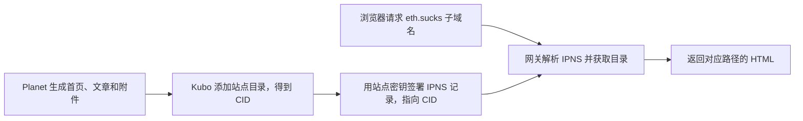

# Planet 与 eth.sucks 使用指南

`eth.sucks` 是访问 IPFS 和 ENS 网站的 HTTPS 网关。V2EX 示例把 Planet 站点的 IPNS 名称放在 `eth.sucks` 前面，普通浏览器通过这个子域名访问站点。[V2EX 示例](https://k51qzi5uqu5dkczezx3wje1dizdk7rta8uc50a5o9ix4wmzqniacrdbfapt8cf.eth.sucks/) · [Planet 的网关说明](https://planetable.sol.build/feature-update-12/)

## 网页是怎么打开的

**CID 对应一个版本。** 站点目录的内容改变时，新目录会得到新的 CID。**IPNS 是可更新的站点地址。** Planet 每次发布时用同一站点密钥更新记录，使原有链接可以指向新版本。网关还要能解析这条记录，并从可达节点获取该版本的数据块。[Planet 发布原理](https://docs.planetable.eth.sucks/ipfs/) · [IPNS 官方文档](https://docs.ipfs.tech/concepts/ipns/)

## 怎么用

### 用已有 IPNS 分享站点

1. 在 Planet 保存并发布站点，取得 `k51…` 开头的 IPNS 名称。
2. 在 Windows 版侧栏的「公共网关」中选择 `eth.sucks`，站点的「复制地址」会生成 `https://<IPNS>.eth.sucks/`。Planet 订阅文章的复制链接也使用所选网关，保留文章路径；普通网页订阅链接保持原样。选择只保存在本机，不会更改 IPNS 发布或同步到其他设备。
3. 在 macOS 原版 Planet 的「设置 → 通用 → IPFS Public Gateway」中选择 `eth.sucks`，再用站点或文章菜单中的 `Open in Public Gateway` 打开。[Planet 的网关说明](https://planetable.sol.build/feature-update-12/)

Windows 版默认使用 `ipfs.io`，还提供 `dweb.link` 和 Aleph Cloud。`eth.sucks` 选项支持 `k51…`、`bafz…` IPNS 名称及 `.eth` ENS 名称；遇到其他格式时请选择路径式网关。网关是否可取回内容仍取决于当时的节点、网络和网关状态。

### 用固定版本或易读名称访问

| 地址 | 用途 |
| --- | --- |
| `https://<IPNS>.eth.sucks/` | 分享会随站点发布更新的地址 |
| `https://yourname.eth.sucks/` | 使用已配置 ContentHash 的 ENS 名称作为访问入口 |

固定 CID 的 `eth.sucks` 子域名尚未验证可用：2026-11-04 对一个临时测试 CID 的请求返回 HTTP 500。排查固定版本时，请使用已验证支持 IPFS 路径的网关，或独立 Kubo 节点；不要仅凭这个地址判断节点是否能提供内容。

已有 `yourname.eth` 且有权修改其记录时，可以通过 ENS App 将 ContentHash 设为 `ipns://<IPNS>` 或 `ipfs://<CID>`。前者跟随站点更新，后者指向固定版本。直接使用 `k51…` 子域名时，IPNS 名称本身就是入口。[ENS 网站配置说明](https://docs.ens.domains/dweb/intro/) · [Planet 对 eth.sucks 的发布说明](https://discuss.ens.domains/t/term-5-grants-summary/18921/11)

## 排查访问问题

本机打开文章后，还需通过公网分别检查 IPNS 能否解析到最新 CID，以及网关能否获取该 CID 的内容。关机后仍需提供站点时，可以让另一台可达节点固定最新 CID，或使用 Planet 支持的固定服务。确认固定状态对应当前 CID，再从外部网络验证分享地址。[IPFS 内容持久化说明](https://docs.ipfs.tech/concepts/persistence/) · [Windows 版固定服务说明](../README.md)

项目提供可选的端到端测试：设置 `PLANET_TEST_KUBO` 为 Kubo 可执行文件路径、`PLANET_TEST_ETH_GATEWAY=1`，运行 `go test ./internal/ipfs -run '^TestEthSucksPublicGateway$' -v -count=1 -timeout=6m`。测试使用临时仓库、临时密钥和每次不同的合成内容，发布到公网，并在节点在线时请求 `eth.sucks`。失败可能发生在发布、DNS、TLS、网关解析或内容取回的不同阶段，应结合错误和独立网络检查，不能把它直接归因于某一环节。

使用 Clash Verge TUN 时，浏览器访问网关和 Kubo 连接 IPFS 节点是两条不同的网络路径。可以按需让 `eth.sucks` 域名及其子域名直连，并为实际运行的 `ipfs.exe` 完整路径单独设置直连；规则变更后重新启动应用，再确认新连接确实命中规则。最新构建也同步到固定路径 `build/windows-amd64/ipfs.exe`；如果运行 `.mygo/releases` 下的独立构建，其路径含构建 ID，规则需要分别匹配。直连仍受网络、NAT 和网关缓存等条件影响，不保证所有网关立即可用。

如果 `ipfs.io` 跳转到 `inbrowser.link` 并显示下载提示，该页面可能正在等待浏览器获取 IPFS 内容。[IPFS 网关调整公告](https://blog.ipfs.tech/2026-10-new-stewards-public-network-services/)
