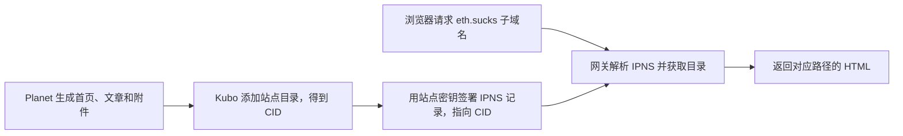

# Planet 与 eth.sucks 使用指南

`eth.sucks` 是访问 IPFS 和 ENS 网站的 HTTPS 网关。V2EX 示例把 Planet 站点的 IPNS 名称放在 `eth.sucks` 前面，普通浏览器通过这个子域名访问站点。[V2EX 示例](https://k51qzi5uqu5dkczezx3wje1dizdk7rta8uc50a5o9ix4wmzqniacrdbfapt8cf.eth.sucks/) · [Planet 的网关说明](https://planetable.sol.build/feature-update-12/)

## 网页是怎么打开的

**CID 对应一个版本。** 站点目录的内容改变时，新目录会得到新的 CID。**IPNS 是可更新的站点地址。** Planet 每次发布时用同一站点密钥更新记录，使原有链接可以指向新版本。网关还要能解析这条记录，并从可达节点获取该版本的数据块。[Planet 发布原理](https://docs.planetable.eth.sucks/ipfs/) · [IPNS 官方文档](https://docs.ipfs.tech/concepts/ipns/)

## 怎么用

### 用已有 IPNS 分享站点

1. 在 Planet 保存并发布站点，取得 `k51…` 开头的 IPNS 名称。Windows 版可从「复制地址」所得的 `https://ipfs.io/ipns/<IPNS>/` 中取出 `/ipns/` 后面的名称。[Windows 版地址生成代码](../src/main.ts)
2. 将站点首页写成 `https://<IPNS>.eth.sucks/`。分享单篇文章时，在同一域名后保留它的 UUID 或已有自定义路径，例如 `https://<IPNS>.eth.sucks/<文章路径>/`。已有站点可以直接用这个地址。
3. 在 macOS 原版 Planet 的「设置 → 通用 → IPFS Public Gateway」中选择 `eth.sucks`，再用站点或文章菜单中的 `Open in Public Gateway` 打开。Windows 0.3 的「复制地址」生成 `ipfs.io` 地址，使用 `eth.sucks` 时按上一步手动拼接。[Planet 的网关说明](https://planetable.sol.build/feature-update-12/)

### 用固定版本或易读名称访问

| 地址 | 用途 |
| --- | --- |
| `https://<IPNS>.eth.sucks/` | 分享会随站点发布更新的地址 |
| `https://<Base32 CIDv1>.eth.sucks/` | 查看某次发布的固定版本，也可用于区分 IPNS 解析和内容获取问题 |
| `https://yourname.eth.sucks/` | 使用已配置 ContentHash 的 ENS 名称作为访问入口 |

已有 `yourname.eth` 且有权修改其记录时，可以通过 ENS App 将 ContentHash 设为 `ipns://<IPNS>` 或 `ipfs://<CID>`。前者跟随站点更新，后者指向固定版本。直接使用 `k51…` 子域名时，IPNS 名称本身就是入口。[ENS 网站配置说明](https://docs.ens.domains/dweb/intro/) · [Planet 对 eth.sucks 的发布说明](https://discuss.ens.domains/t/term-5-grants-summary/18921/11)

## 排查访问问题

本机打开文章后，还需通过公网分别检查 IPNS 能否解析到最新 CID，以及网关能否获取该 CID 的内容。关机后仍需提供站点时，可以让另一台可达节点固定最新 CID，或使用 Planet 支持的固定服务。确认固定状态对应当前 CID，再从外部网络验证分享地址。[IPFS 内容持久化说明](https://docs.ipfs.tech/concepts/persistence/) · [Windows 版固定服务说明](../README.md)

如果 `ipfs.io` 跳转到 `inbrowser.link` 并显示下载提示，该页面可能正在等待浏览器获取 IPFS 内容。[IPFS 网关调整公告](https://blog.ipfs.tech/2026-10-new-stewards-public-network-services/)
